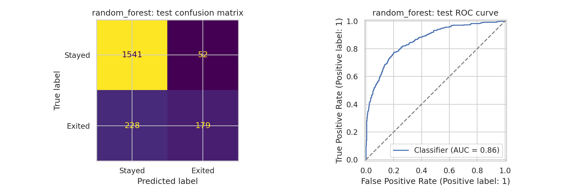
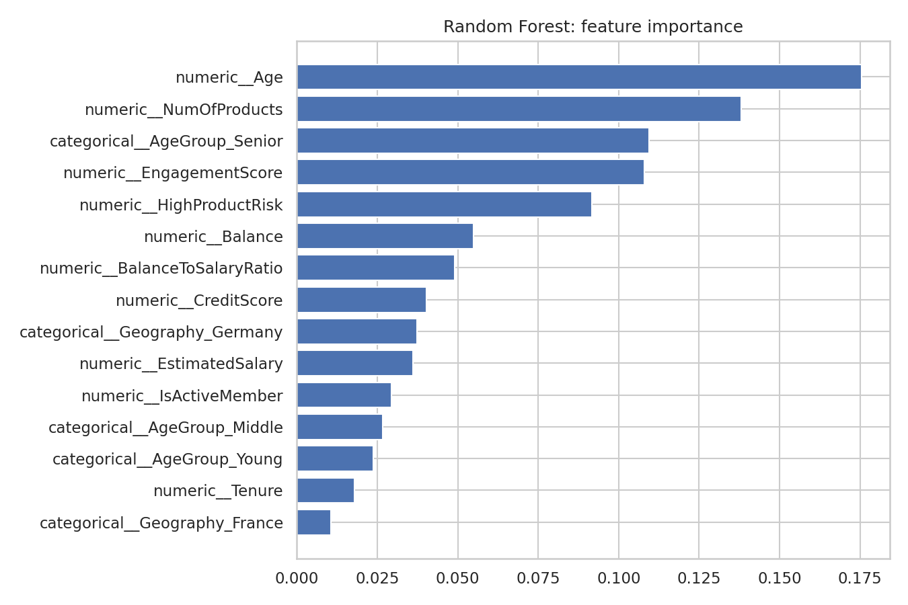

# Bank Customer Churn Prediction Using Machine Learning

A reproducible classification project that estimates whether a bank customer will exit. It compares **Logistic Regression, Random Forest, and XGBoost**, selects a model using validation ROC-AUC, and evaluates that selected pipeline on a separate test set.

The completed Kaggle experiment selected **Random Forest**, achieving **86.0% test accuracy** and **0.8615 test ROC-AUC** on **2,000 customers**. The original data, models, reports, predictions, and plots are included. Training runs locally or in Kaggle; deployment is outside this project's scope.

## Verified results

The following numbers come from the supplied Kaggle run, rather than a new training run or an upstream repository.

| Metric | Random Forest test result |
|---|---:|
| Accuracy | 86.00% |
| Precision for churn | 77.49% |
| Recall for churn | 43.98% |
| F1-score for churn | 0.5611 |
| ROC-AUC | 0.8615 |
| Decision threshold | 0.5 |
| Test customers | 2,000 |

At this threshold, **228 of 407 churners were missed**. The model correctly classified 1,720 customers. An always-stayed classifier would achieve 79.65% accuracy, so the model improves accuracy by **6.35 percentage points**. Accuracy alone is insufficient to assess churn detection.



## Workflow

1. Validate the CSV, remove exact duplicates, and require unique customer IDs.
2. Split customers into **60% training, 20% validation, and 20% test**, stratified by `Exited`, using seed **42**.
3. Build five engineered features inside a reusable transformer.
4. Fit imputation, one-hot encoding, and standard scaling **only on training data**.
5. Fit an independent preprocessing/model pipeline for each classifier.
6. Select the highest validation ROC-AUC; evaluate only the selected model on test.
7. Save fitted pipelines, metrics, customer predictions, feature importance, and plots.

`RowNumber`, `CustomerId`, and `Surname` are excluded from model inputs. `CustomerId` is retained for split verification and prediction traceability. `Exited` is the target: **0 = stayed, 1 = exited**.

## Validation comparison

| Model | Accuracy | Precision | Recall | F1 | ROC-AUC |
|---|---:|---:|---:|---:|---:|
| Random Forest | 0.8685 | 0.7843 | 0.4902 | 0.6033 | **0.874107** |
| XGBoost | 0.8625 | 0.7270 | 0.5221 | 0.6077 | 0.873240 |
| Logistic Regression | 0.8615 | 0.7472 | 0.4853 | 0.5884 | 0.859158 |

Random Forest was selected by ROC-AUC. Its AUC lead over XGBoost is approximately **0.000867**; this run does not demonstrate statistically significant superiority. XGBoost had the higher validation recall and F1. Test results for the two unselected models are not claimed.

## Dataset

The provided `Churn_Modelling.csv` contains **10,000 rows and 14 columns**. It has **2,037 exited customers (20.37%)**, no exact duplicate rows, and no missing required fields in this run.

| Split | Customers | Stayed | Exited |
|---|---:|---:|---:|
| Training | 6,000 | 4,778 | 1,222 |
| Validation | 2,000 | 1,592 | 408 |
| Test | 2,000 | 1,593 | 407 |

Dataset provenance: [Bank Customer Churn Prediction on Kaggle](https://www.kaggle.com/datasets/shantanudhakadd/bank-customer-churn-prediction), as referenced by the uploaded source project. This repository uses the exact CSV supplied with that project. See [data/README.md](data/README.md) for the schema and its SHA-256 hash.

## Feature engineering

| Feature | Definition |
|---|---|
| `TenureGroup` | `pd.cut` bins `[0, 3, 6, 9, 11]`, right-closed and including the lowest value |
| `AgeGroup` | `pd.cut` bins `[0, 30, 45, 60, 100]`, right-closed and including the lowest value |
| `BalanceToSalaryRatio` | `Balance / (EstimatedSalary + 1)` |
| `HighProductRisk` | 1 when `NumOfProducts >= 3`; missing product counts remain missing |
| `EngagementScore` | `IsActiveMember + NumOfProducts / 4` |

The pipeline transforms 10 raw input fields into 15 fields after feature engineering and **24 encoded columns** in the original run. Numeric columns use median imputation and `StandardScaler`; categorical columns use most-frequent imputation and `OneHotEncoder(handle_unknown="ignore")`.



Age has the highest individual tree importance, followed by number of products. These are impurity-based model importance scores, **not causal effects**; correlated raw and engineered features share importance.

## Quick start: local Python

Use **Python 3.12** for the tested repository setup. Run commands from the extracted repository folder:

```bash
python -m venv .venv
```

Activate the environment:

```bash
# Windows PowerShell
.venv\Scripts\Activate.ps1

# macOS / Linux
source .venv/bin/activate
```

Install dependencies and verify the included experiment:

```bash
python -m pip install -r requirements.txt
python -m bank_churn.verify --check-model
```

### Predict using the original Random Forest

```bash
python -m bank_churn.predict --input examples/new_customers.csv --output predictions/new_customers.csv
```

The example records reproduce the original predictions:

| Example | Churn probability | Predicted churn |
|---|---:|---|
| Credit score 750, age 35, active member, two products | 0.0695043150 | No |
| Credit score 450, age 55, inactive member, three products | 0.9167237055 | Yes |

These examples have no independently observed outcomes; they demonstrate inference, not additional validation. The raw input schema is in [examples/README.md](examples/README.md).

### Train all three models

```bash
python -m bank_churn.train
```

Each run writes to a separate timestamped directory under `artifacts/runs/`, which is ignored by Git. The original `artifacts/kaggle_run/` is preserved.

To choose paths explicitly:

```bash
python -m bank_churn.train --data data/raw/Churn_Modelling.csv --output artifacts/runs/my_run
python -m bank_churn.verify --run artifacts/runs/my_run --check-model
python -m bank_churn.predict --model artifacts/runs/my_run/best_churn_pipeline.joblib --input examples/new_customers.csv --output predictions/my_run.csv
```

Training refuses to write into a nonempty output directory. The selected pipeline is saved **without refitting on validation or test data**.

## Run in Kaggle

Import [notebooks/Customer_Churn_Kaggle.ipynb](notebooks/Customer_Churn_Kaggle.ipynb). Attach this repository as a private dataset, or attach a dataset containing the supplied `Churn_Modelling.csv`. Use CPU; Internet is needed only if a dependency is missing and must be installed. Run the cells in order.

The standalone notebook automatically finds the CSV directly or inside a ZIP. It writes to `/kaggle/working/churn_outputs` and produces `/kaggle/working/customer_churn_outputs.zip`. It embeds its preprocessing module, so it does not require the repository package to be installed.

## Reproducibility and saved models

- The original CSV SHA-256, split assignments, package versions, and metrics are recorded in `artifacts/kaggle_run/run_metadata.json` and related files.
- Original artifacts are preserved byte for byte, excluding Python caches; an artifact hash manifest is included.
- The original models use **scikit-learn 1.6.1**. The tested requirements pin this version so the included Random Forest can be loaded correctly. The prediction command checks for a recorded scikit-learn version mismatch before loading.
- The recorded Kaggle run used Python 3.13.15, pandas 2.3.3, NumPy 2.1.3, XGBoost 3.4.1, and joblib 1.6.0. `requirements.txt` describes the **tested local runtime**, not a claim that it duplicates every Kaggle package version.
- Retraining can produce different scores, particularly with a different XGBoost version. Original results remain the authoritative record of the completed Kaggle run.
- The tested local runtime reproduces the original Random Forest's saved test and example predictions within `1e-12` absolute tolerance. The original XGBoost artifact is preserved; cross-version XGBoost artifact loading has not been verified.
- The root `churn_preprocessing.py` retains the import path used by the saved pipelines. Keep it available when loading them. Load joblib files only from a trusted source.

See [docs/EXPERIMENT.md](docs/EXPERIMENT.md) for exact estimator settings and [docs/RESULTS.md](docs/RESULTS.md) for result interpretation.

## Repository contents

| Path | Purpose |
|---|---|
| `bank_churn/` | Modular training, prediction, preprocessing, plotting, and verification |
| `churn_preprocessing.py` | Original shared feature transformer and model compatibility |
| `data/raw/Churn_Modelling.csv` | Exact 10,000-customer input dataset |
| `examples/` | Raw customer CSV and prediction instructions |
| `notebooks/Customer_Churn_Kaggle.ipynb` | Standalone Kaggle workflow |
| `artifacts/kaggle_run/` | Original fitted models, metrics, predictions, plots, and provenance |
| `docs/` | Methodology, results, and GitHub upload instructions |
| `tests/` | Data-split, leakage, serialization, input-schema, and result checks |
| `.github/workflows/checks.yml` | Workflow to verify artifacts and run tests on GitHub |

## Tests

```bash
python -m pip install -r requirements-dev.txt
python -m pytest -q
```

Checks cover the original split, independently recalculated metrics, original saved-model predictions, training-only scaling, unseen categories, missing-value handling, input validation, and model serialization. The GitHub Actions configuration performs verification and tests after a push or pull request.

Repository preparation completed **11 passing regression checks** and a full local training run that reproduced the original Random Forest test predictions. See [docs/VALIDATION.md](docs/VALIDATION.md) for the tested runtime and verification scope.

## Limitations

- Churn recall is **43.98% at the fixed 0.5 threshold**, so many churners are missed.
- The benchmark has no observation dates, so evaluation uses a random stratified split rather than a chronological split.
- Results are from one split and one seed; external-bank validation and confidence intervals are not implemented.
- Probabilities are not calibrated. Threshold optimization, SMOTE, hyperparameter searches, and business-impact experiments are not implemented.
- Data preprocessing prevents fitted-transform leakage across splits; this does not establish that the benchmark is free of all sampling bias.
- There is no deployed API, UI, database, or automated monitoring service in this repository.


  
